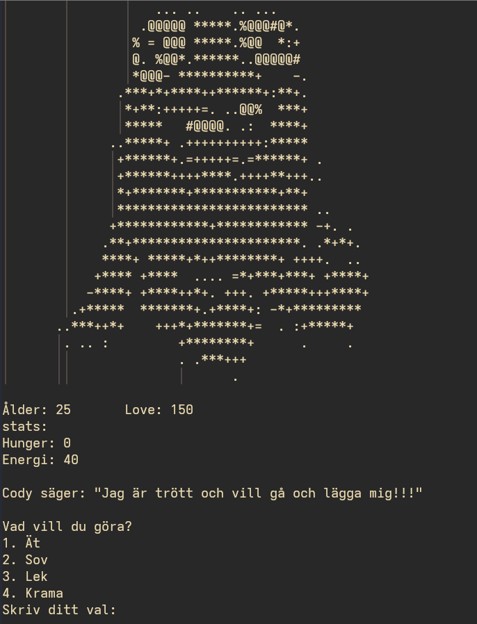

# Beskrivning

Cody har följande Stats, alltså värden som kan ökas/minskas beroende på vad du gör.
Stats:
- age
  - Ökar varje gång den sover.
- love/bonding
  - Ökar varje gång du kramar eller leker med den
- hunger
  - Ökar med +5 om man sover, +1 för allt annat. -5 om den äter.

Programmet rör sig framåt med hjälp av att du väljer ett alternativ av vad Cody ska göra utifrån en viss mängd av alternativ. Till exempel:
1. Ät
2. Sov
3. Lek
4. Krama

Gränsnittet kan skapas på flera sätt.
- I Python med terminalen som gränsnitt. Du printar ut text och får in text genom den inbyggda input() funktionen. Du kan visa en ASCII-bild av Cody.
- I Python med TKinter för att skapa ett ännu mer grafiskt gränsnitt.
- Som webbsida.

<!--  -->

## Möjligheter till utökning:
- Meddelanden som Cody säger om den t.ex. blir för hungrig eller trött.
- Möjligheten för Cody att dö ifall du inte matar honom.
- lägg till ett av de tidigare projekten, t.ex. sten sax påse så att du kan spela det med Cody.
